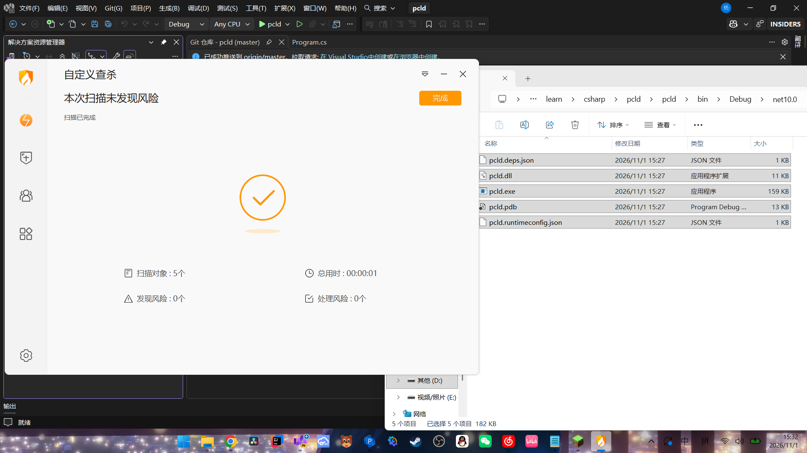

# pcld
这是一个开源的项目，用于下载Minecraft的版本Json文件，程序简单，api来源Mojang的公开接口（见代码）
下载到的程序会被存储。

免责声明：本程序仅提供Mojang公开api的版本Json文件下载器，完全免费，开源。
请勿相信任何第三方下载渠道，程序仅分发于github，由第三方修改、重新打包的 PCLD 产生的安全问题与原作者无关。
"Minecraft"以及"我的世界"为美国微软公司的商标 开发者与微软公司没有任何隶属关系！

#安全软件扫描

# 开源协议
本项目采用 GNU General Public License v3.0 (GPL v3) 开源协议。详细信息请参阅 LICENSE 文件。

